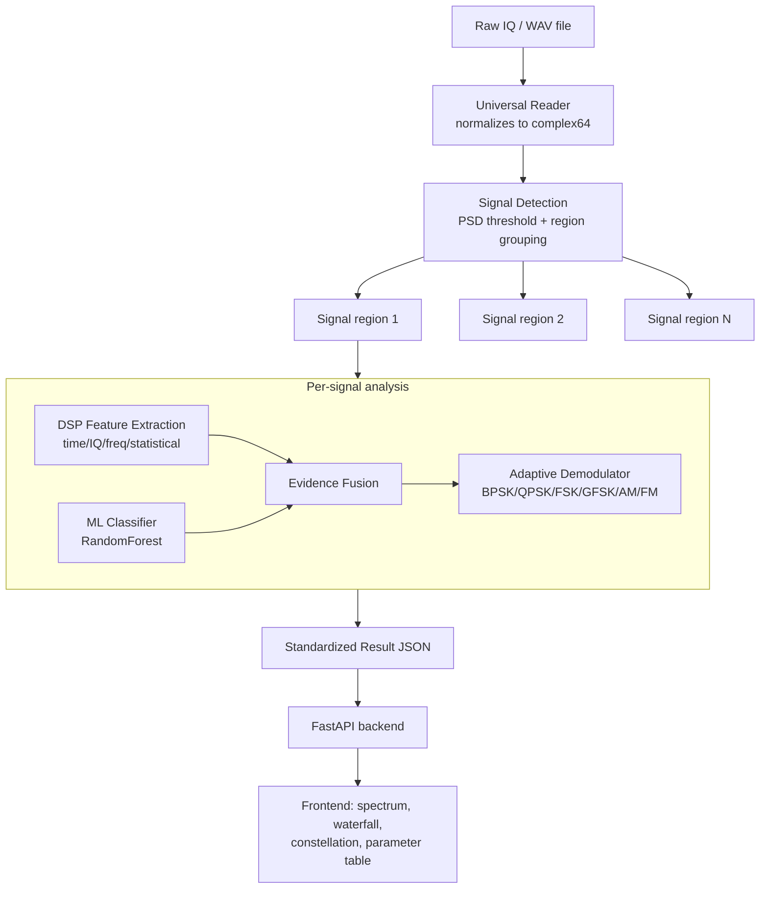

# RF Signal Analysis Prototype — SIH Problem Statement

**Automated model for analysis of .IQ and .WAV files with signal parameter extraction.**

A working end-to-end pipeline: raw IQ/WAV → signal detection → DSP feature
extraction → ML modulation classification → DSP+ML evidence fusion →
demodulation → REST API, built for a Smart India Hackathon demo.

---

## 1. Problem

Off-air RF captures (a few kHz to GHz) are easy to eyeball on a spectrum
analyzer for coarse parameters (center frequency, rough bandwidth), but
fine-grained parameters — modulation type, symbol rate, carrier offset, SNR —
require real signal-processing work. This prototype automates that pipeline
for **8 modulation classes**: BPSK, QPSK, 8PSK, 16QAM, FSK, GFSK, AM, FM.

## 2. Architecture



**Design principle (non-negotiable):** DSP computes physically measurable
quantities (SNR, bandwidth, carrier offset, symbol rate). ML only does what
DSP can't — classify modulation from a pattern in the feature space. Neither
component is allowed to fabricate a value it can't actually determine; every
field in the result JSON is tagged with its `source`.

## 3. Directory structure

```
rf_signal_project/
    dataset/raw/{iq,wav}/          generated signals
    dataset/metadata/              metadata.jsonl, metadata.csv, feature cache
    models/modulation_model.pkl    trained classifier (RandomForest + scaler)
    src/dataset/                   signal generators + dataset builder
    src/io/                        .iq / .wav readers, format normalization
    src/dsp/                       FFT, PSD, bandwidth, SNR, offset, symbol rate, features
    src/ml/                        feature table builder, train, evaluate, predict
    src/demod/                     BPSK/QPSK/FSK/GFSK/AM/FM demodulators
    src/pipeline/                  detector, fusion, analyzer (ties it together)
    api/main.py                    FastAPI backend
    demo_generate.py               generates the 5 demo test recordings
    tests/                         pytest suite (19 tests)
```

## 4. Metadata schema

Every generated signal gets a JSON record (see `src/dataset/metadata_schema.py`
for full field docs) such as:

```json
{
  "sample_id": "sample_000001",
  "modulation": "QPSK",
  "sample_rate_hz": 1000000,
  "symbol_rate_hz": 100000,
  "snr_db": 10,
  "carrier_offset_hz": 5000,
  "bandwidth_hz": 120000,
  "pulse_shape": "RRC",
  "rolloff": 0.35,
  "channel": "AWGN",
  "fec": "none",
  "interleaving": "none",
  "split": "train"
}
```

**Every field's provenance is tracked.** For synthetic data, physical
parameters are `ground_truth` (we generated the waveform, so we know them
exactly). For a real capture, the same schema applies but most fields become
`dsp_estimated` or `unknown` — the code path doesn't change, only the values
do. See `SCHEMA_FIELD_DOCS` in `metadata_schema.py`.

## 5. DSP pipeline — algorithms used

| Estimator | Method |
|---|---|
| Occupied bandwidth | 99%-power method on Welch PSD (ITU-R SM.328 style) |
| SNR | Histogram-based noise-floor mode + signal/noise bin split |
| Carrier offset (PSK/QAM) | M-th power estimator (raise to M, FFT peak / M) |
| Carrier offset (FSK/AM/FM) | PSD peak / spectral centroid |
| Symbol rate | Power-waveform spectral line search (cyclostationary-style) |
| Features | 23 time/IQ/frequency/statistical features (crest factor, kurtosis, spectral flatness, instantaneous frequency stats, etc.) |

Full docstrings with the exact algorithm are in each `src/dsp/*.py` file.

## 6. ML pipeline

- **Model:** RandomForestClassifier (300 trees, balanced class weights) —
  fast, interpretable, trains in seconds on a laptop, no GPU.
- **Train/test split — NOT random shuffling.** `generate_dataset.py` tags
  every example `train` or `test` based on held-out conditions: **SNR = 20dB
  OR |carrier offset| = 20kHz → test**, everything else → train. This tests
  generalization to unseen SNR/offset conditions instead of measuring
  memorization of highly-correlated synthetic frames.
- **Measured held-out accuracy on this run: 70.0%** (see
  `results/evaluation_report.txt` for full per-class precision/recall/F1 and
  confusion matrix). AM/FM/16QAM are strong (80–95% F1); FSK vs GFSK and
  QPSK vs 8PSK are the main confusion pairs — expected, since GFSK is
  literally FSK with a smoothing filter, and 8PSK contains QPSK's 4 phase
  states as a subset.

## 7. Evidence fusion (not blind ML trust)

`src/pipeline/fusion.py` checks the ML prediction against independent DSP
signals: envelope-variance (constant vs varying envelope), PAPR, and
symbol-rate estimator confidence. Agreement → "High"/"Medium" confidence;
disagreement → "Low" confidence, stated explicitly in the evidence list. This
is intentionally simple, rule-based, and explainable — not a second ML model.

## 8. Demodulation

Implemented: **BPSK, QPSK, FSK, GFSK, AM, FM** (the Section-13 minimum set).
8PSK and 16QAM correctly report `"supported": false` rather than crashing or
faking output — this is a known limitation, not a bug (see §12 below).

## 9. API

FastAPI backend (`api/main.py`) implements all endpoints from the spec:
`/health`, `/upload`, `/analyze`, `/result/{id}`, `/spectrum/{id}`,
`/spectrogram/{id}`, `/constellation/{id}`, `/signals/{id}`,
`/demodulate/{id}`. All smoke-tested with FastAPI's TestClient.

## 10. Frontend contract

Every parameter in the result JSON carries a `source` field so a frontend
can display, e.g.:

```
Sample rate     1 MS/s        SOURCE: FILE METADATA
SNR             14.8 dB       SOURCE: DSP ESTIMATION
Modulation      QPSK          SOURCE: ML + DSP FUSION
Symbol rate     99.4 kSym/s   SOURCE: DSP ESTIMATION
FEC             none          SOURCE: GROUND TRUTH (synthetic only)
```

## 11. FEC / interleaving

**Not implemented for the demo**, by design (Section 17 of the spec — it's
explicitly deprioritized). The metadata schema already supports `fec` and
`interleaving` fields (`none/convolutional/BCH/reed_solomon/LDPC/unknown`),
so this can be added later without a schema migration. Real identification
would require known training sequences, redundancy/parity checks, or
candidate-decode-success testing — none of which is implemented here.

## 12. Honest limitations (read this before your demo)

- **Demodulators are simplified.** No PLL/timing-recovery loop — coarse
  carrier correction + fixed downsampling. Works on clean synthetic signals,
  will degrade on real captures with drifting oscillators.
- **8PSK/16QAM demodulation is not implemented.**
- **Bandwidth estimates can run high** on RRC-shaped signals with excess
  noise bandwidth included — it's a real measurement of the 99%-power window,
  not a fabricated number, but don't claim laboratory-grade precision.
- **Symbol-rate estimator can lock onto pulse-shaping harmonics** at low SNR.
- **Wideband multi-signal classification is less reliable than single-signal**
  classification — filtering/extraction of each region introduces distortion
  the classifier wasn't trained on. The fusion layer's "Low confidence" flag
  is doing its job here, not failing.
- **All ground-truth numbers are synthetic.** No real SDR validation yet
  (see §14).

## 13. Real-world dataset strategy

This synthetic generator is deliberately complementary to public datasets,
not a replacement:

| Dataset | Best use |
|---|---|
| DeepSig RadioML 2018.01A / 2016.10A | Modulation classification benchmarking against published baselines |
| HisarMod | Channel-robustness testing (more channel diversity than RadioML) |
| ElectroSense | Real-world wideband detection validation |
| This synthetic generator | Exact ground truth for symbol rate, SNR, carrier offset — impossible to get from any real recording — plus fast iteration without downloading gigabytes |

Not used tonight because downloading/training on RadioML (2.5M+ examples) is
not compatible with a same-day demo deadline — this is stated as future work,
not hidden.

## 14. Real SDR validation (future work)

`src/io/universal_reader.py` already refuses to guess a sample rate it
doesn't have (`sample_rate_source: "unknown"` if no sidecar/WAV header/user
input) rather than pretending arbitrary raw IQ reveals its own ADC rate. For
real recordings, plug in: a `--sample-rate` CLI flag or the `/analyze`
endpoint's `sample_rate_hz` form field, SNR from `dsp_estimated` (already
implemented), and expect FEC/interleaving/modulation confidence to be lower
than on synthetic data — that's expected, not a bug.

---

## Running it (Windows PowerShell)

```powershell
# 1. Setup
python -m venv venv
venv\Scripts\activate
pip install -r requirements.txt

# 2. Generate the training dataset (few minutes; tune --samples-per-condition
#    down for a faster/smaller run, or up for better accuracy)
python src\dataset\generate_dataset.py --samples-per-condition 4 --n-symbols 1500

# 3. Train the classifier (caches DSP features to speed up re-runs)
python src\ml\train_modulation.py

# 4. Evaluate on the held-out split
python src\ml\evaluate.py

# 5. Generate the 5 named demo recordings (Section 22), including the
#    headline wideband multi-signal file
python demo_generate.py

# 6. Run tests
python -m pytest tests\ -q

# 7. Start the API
python -m uvicorn api.main:app --reload
# then POST demo_data\test5_wideband.iq to /upload, then /analyze with
# sample_rate_hz=2000000 and wideband=true
```

### Expected outputs
- `dataset/` — ~4,800 IQ+WAV files with full metadata (with defaults above)
- `models/modulation_model.pkl` — trained model (~70% held-out accuracy)
- `demo_data/test5_wideband.iq` — 3 signals at 100kHz/350kHz/650kHz
- API running at `http://127.0.0.1:8000`, docs at `/docs`

### Troubleshooting
- **`ModuleNotFoundError: src`** — run scripts from the project root, or note
  each script inserts the project root into `sys.path` automatically.
- **GNU Radio not installed** — not required; this prototype is pure
  Python/NumPy/SciPy by design (Section 24), specifically so it's not
  blocked by GNU Radio's notoriously painful Windows install.
- **Training slow** — reduce `--samples-per-condition` and `--n-symbols` in
  step 2, or reuse the feature cache at
  `dataset/metadata/features_cache.parquet` (train_modulation.py does this
  automatically after the first run).

---

## 15. For SIH judges — honest self-assessment

**Genuinely innovative:**
- The DSP/ML fusion layer that actively downgrades confidence on
  disagreement, rather than reporting raw softmax scores as if they were
  ground truth.
- The held-out generalization split (by SNR/offset, not random shuffle) —
  most hackathon submissions randomly split correlated synthetic frames and
  report inflated accuracy.
- Explicit source-tagging on every output field (`ground_truth` /
  `dsp_estimated` / `ml_predicted` / `unknown`) baked into the schema, not
  bolted on for the demo.

**Only a baseline:**
- RandomForest on hand-crafted features, not a learned representation
  (no CNN/transformer on raw IQ or spectrograms — a legitimate future upgrade).
- Demodulators lack proper PLL/Costas-loop carrier and Mueller-and-Müller
  timing recovery.
- Signal detector uses a simple threshold, not CFAR (constant false-alarm
  rate) detection used in real SIGINT tooling.

**Claims to avoid making:**
- Do NOT claim you can recover the ADC sample rate from arbitrary raw IQ
  with no metadata — the code explicitly refuses to guess this.
- Do NOT claim FEC/interleaving detection works — it's schema-ready, not
  implemented.
- Do NOT claim the wideband detector performance matches per-signal
  performance — show the confidence labels honestly.
- Do NOT claim validation on real SDR captures — everything shown is
  synthetic.

**What a DSP expert would challenge:** the demodulators' lack of a proper
carrier/timing recovery loop; the symbol-rate estimator's fragility at low
SNR/high roll-off; the bandwidth estimator's inclusion of shaping-filter
excess bandwidth.

**What an ML expert would challenge:** hand-crafted features vs. learned
representations; RandomForest's ceiling vs. even a small CNN; no
cross-validation, just a single held-out split; class imbalance handling
(`class_weight="balanced"` is a first-pass fix, not a full solution).

**What a police/defence-domain judge would ask:** "Does this work on a real
capture from an actual receiver?" (Answer honestly: not yet validated — that
is the immediate next step, and the architecture is built to support it
without code changes.) "How do you handle unknown/novel modulations?" (Answer
honestly: the classifier only recognizes its 8 trained classes; an
out-of-distribution detector is future work.)

**Experiments to show live:** the held-out confusion matrix, the wideband
3-signal detection + classification with confidence labels, one deliberately
low-SNR example where fusion downgrades to "Low" confidence to prove the
system isn't blindly confident.

**Metrics to display:** per-class F1, the confusion matrix, and the
confidence-label breakdown (how often High/Medium/Low correlates with actual
correctness) — the last one is the most convincing "we thought about this"
signal you can show a judge.

**Future work (say this out loud, don't hide it):** FEC/interleaving
classification, proper carrier/timing recovery loops, CNN/transformer on raw
IQ or spectrogram images, CFAR detection, real SDR validation against
RadioML/HisarMod/ElectroSense, 8PSK/16QAM demodulation.
